<p align="center">
  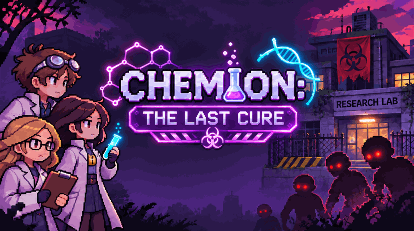
</p>

<h1 align="center">CHEMION: The Last Cure</h1>

<p align="center">
  <i>When humanity falls, science becomes its last hope.</i>
</p>

<p align="center">
  
  
  
  
  
</p>

<p align="center">
  <b>EXPLORE • INVESTIGATE • SYNTHESIZE • SURVIVE</b>
</p>

---

## 🧬 Project Overview

**CHEMION: The Last Cure** is a Java-based educational 2D role-playing desktop game that combines chemistry, survival, exploration, and strategic combat in a post-apocalyptic world.

A catastrophic scientific outbreak has transformed ordinary humans into dangerous infected creatures. As one of five scientists, the player embarks on a mission to investigate the infection, uncover classified research, collect chemical materials, and develop specialized treatments.

Through interactive laboratory challenges, potion crafting, and real-time combat, players apply fundamental chemistry concepts while discovering the truth behind the outbreak.

Unlike traditional educational games, CHEMION integrates learning directly into its gameplay, encouraging players to think critically, experiment, and apply scientific knowledge to overcome challenges.

<p align="center">
  <b>Science is not just knowledge. It is humanity's last weapon.</b>
</p>

---

## 🧪 Project Features

| Feature | Description |
|---|---|
| 👨‍🔬 Playable Scientists | Choose from five scientists before beginning the mission. |
| 🗺️ Five Progressive Levels | Explore unique infected environments with increasing difficulty. |
| ⚗️ Potion Crafting | Combine chemical elements and materials to develop specialized treatments. |
| ⚔️ Real-Time Combat | Cure infected individuals using appropriate potions and strategic movement. |
| 🔍 Investigation System | Discover hidden research records, clues, and secrets behind the outbreak. |
| 🧩 Chemistry Challenges | Apply chemistry knowledge to interactive laboratory activities. |
| 📖 Research Journal | Access enemy information, chemical properties, and discovered recipes. |
| 🎒 Inventory System | Manage chemical materials, crafted potions, and healing items. |
| 🛒 Shop System | Purchase ingredients and supplies using earned coins. |
| 🧬 Enemy Mutations | Encounter different infected creatures with unique characteristics and weaknesses. |
| ☣️ Boss Battles | Confront powerful mutations requiring specialized treatments and strategies. |
| 🏆 Reward System | Earn experience points, coins, and materials through successful encounters. |
| 🎬 Cinematic Storytelling | Discover the outbreak's history through narrative sequences and investigations. |
| 🎨 Pixel-Art Graphics | Experience animated characters, enemies, and detailed environments. |
| 🎵 Audio System | Experience atmospheric music and gameplay sound effects. |
| 💾 Save and Continue | Preserve progress and return to unlocked levels. |

---

<h2 align="center">🖥️ Game Interface</h2>

CHEMION features a graphical desktop interface designed around a dark purple, post-apocalyptic scientific theme.

<p align="center">
  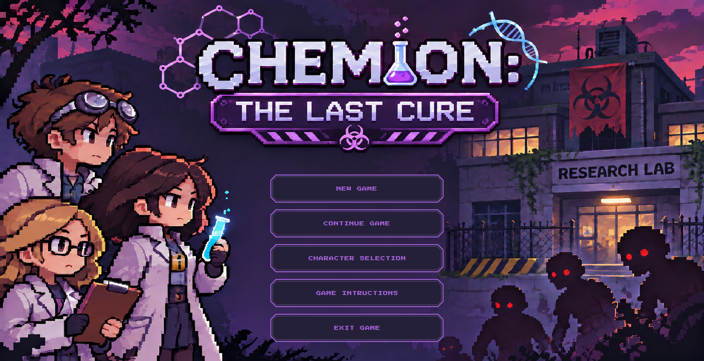
</p>

<p align="center">
  <b>Main Menu</b>
</p>

<table>
  <tr>
    <td align="center" width="50%">
      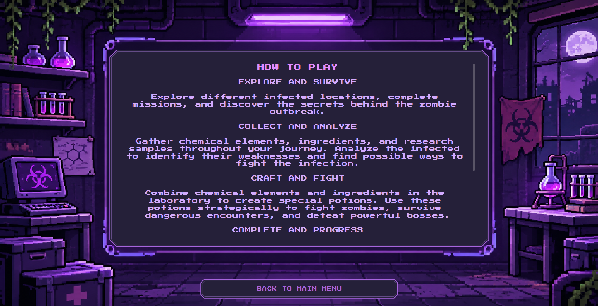
      <br>
      <b>Game Instructions</b>
    </td>
    <td align="center" width="50%">
      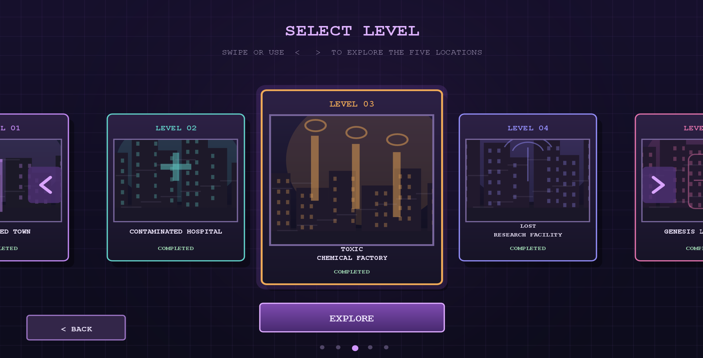
      <br>
      <b>Continue Game</b>
    </td>
  </tr>
</table>

---

<h2 align="center">👨‍🔬 Playable Scientists</h2>

<p align="center">
  <b>FIVE SCIENTISTS. ONE MISSION. HUMANITY'S LAST HOPE.</b>
</p>

<p align="center">
  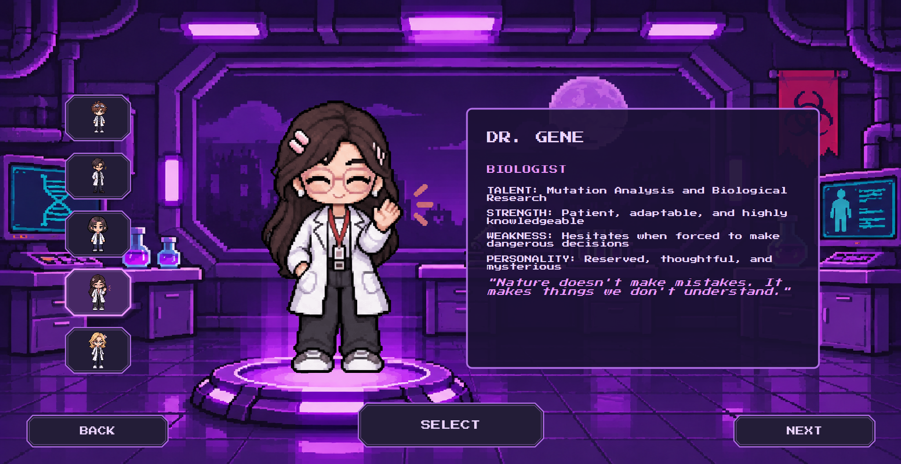
  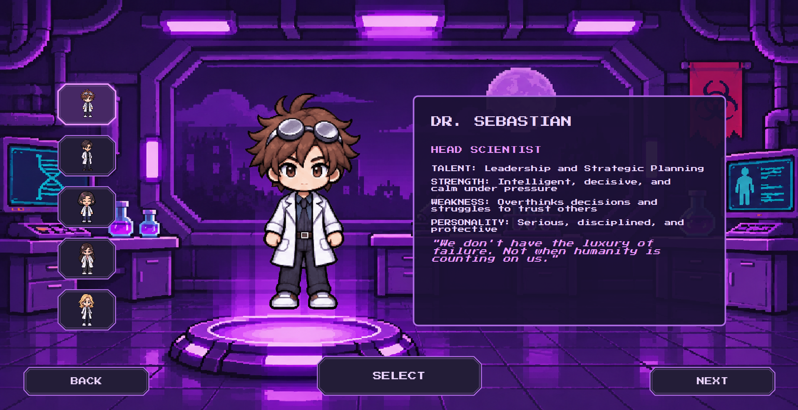
</p>

<p align="center">
  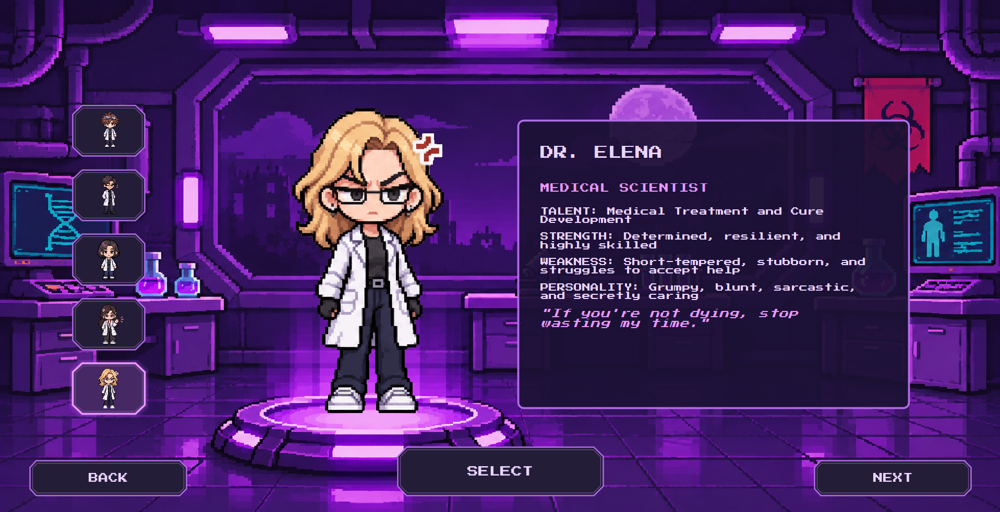
  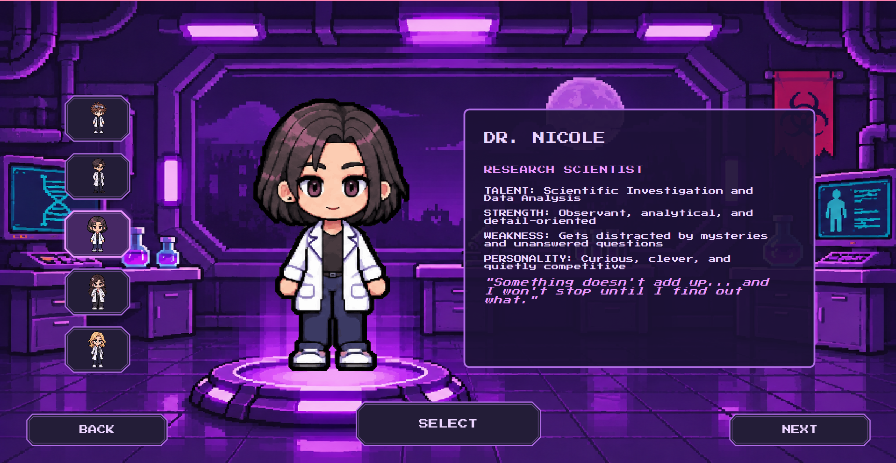
  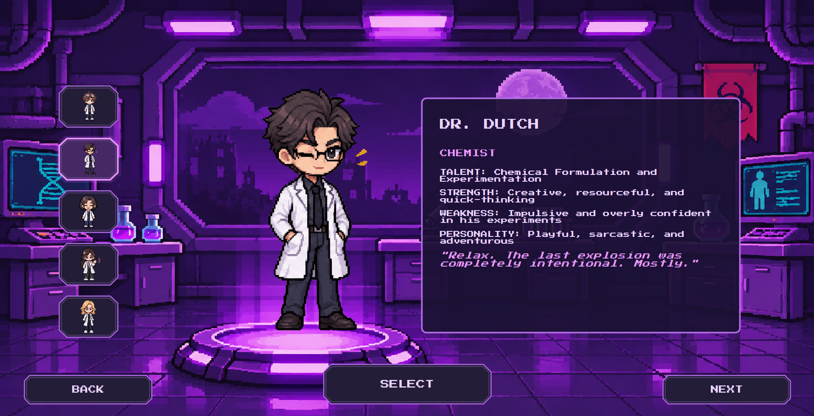
</p>

Each scientist represents humanity's determination to survive through knowledge, research, and scientific discovery.

Players select their preferred scientist and use that character throughout their journey across the infected world.

---

## 🎮 Gameplay Mechanics

### 🔍 Explore

Navigate infected locations, investigate suspicious areas, and discover research materials connected to the outbreak.

### 🧬 Analyze

Each zombie has its own description, characteristics, chemical weaknesses, and treatment clues to guide players in developing appropriate potions.

### ⚗️ Synthesize

Collect chemical ingredients and combine the appropriate materials in the laboratory to craft specialized potions.

### ⚔️ Combat

Use crafted treatments against infected creatures while managing health, movement, inventory, and available resources.

### 🏆 Progress

Earn experience points, coins, and materials. Complete objectives, overcome chemistry challenges, defeat bosses, and unlock subsequent levels.

<p align="center">
  <b>EXPLORE → ANALYZE → SYNTHESIZE → COMBAT → PROGRESS</b>
</p>

---

<h2 align="center">⚔️ Battlefield</h2>

The journey consists of five increasingly challenging locations. Each battlefield introduces new environments, infected creatures, scientific discoveries, and obstacles that bring the player closer to the origin of the outbreak.

Chemical formulation and potion crafting serve as core chemistry challenges across all five levels, with increasingly complex ingredient combinations as players progress. Additional chemistry challenges are introduced in later levels to further develop players' scientific knowledge and problem-solving skills.

### Level 01 — Abandoned Town

<p align="center">
  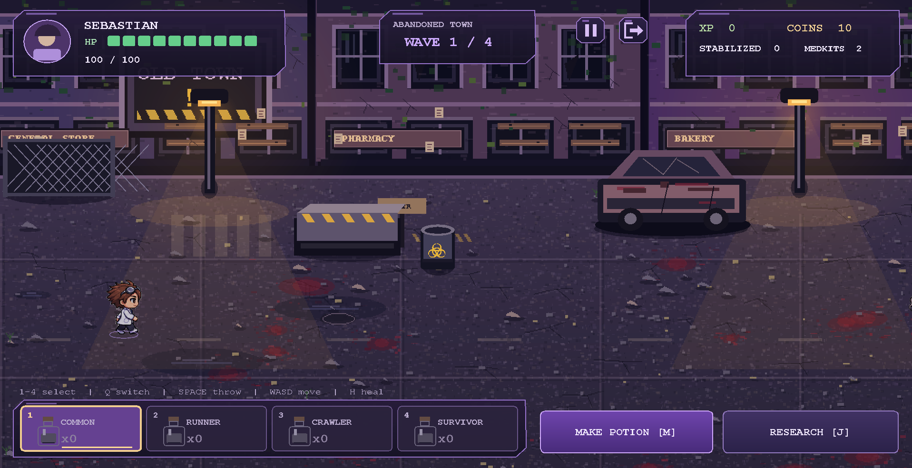
  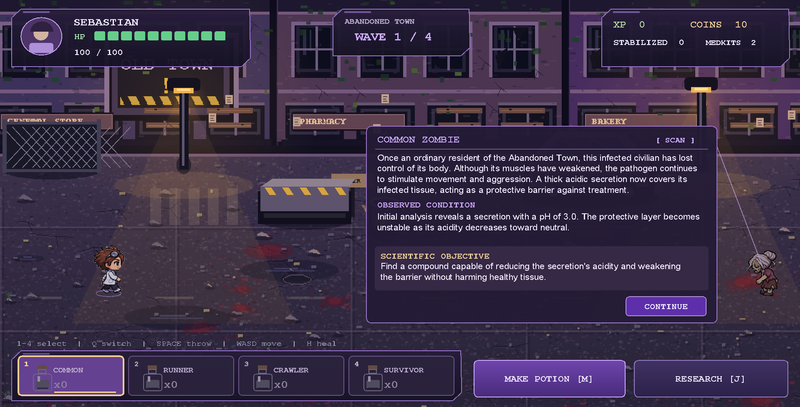
  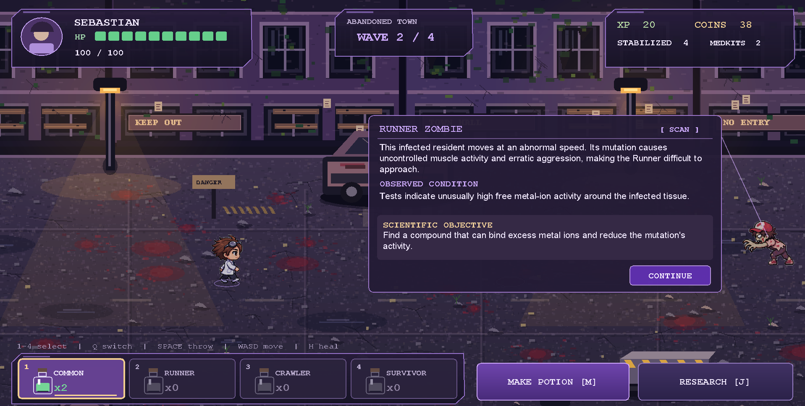
</p>

The journey begins in an abandoned town overwhelmed by infected residents. Players discover the fundamentals of exploration, chemical analysis, potion crafting, and survival.

| Classification | Details |
|---|---|
| Difficulty | Easy |
| Enemies | Common Zombie, Runner Zombie, Crawler Zombie |
| Boss | Mutated Survivor |
| Chemistry Challenges | Chemical Formulation and Potion Crafting |

---

### Level 02 — Contaminated Hospital

<p align="center">
  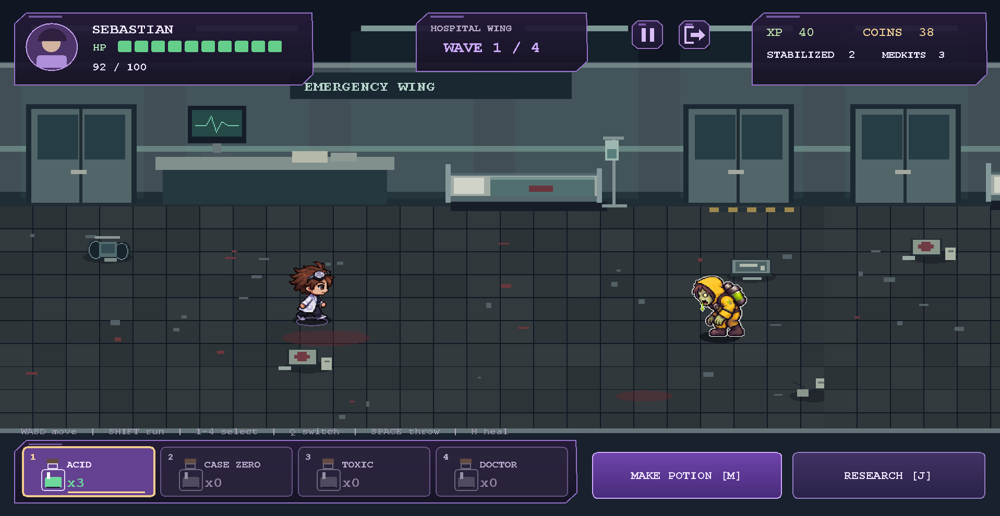
  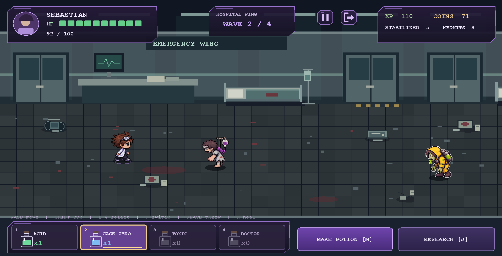
  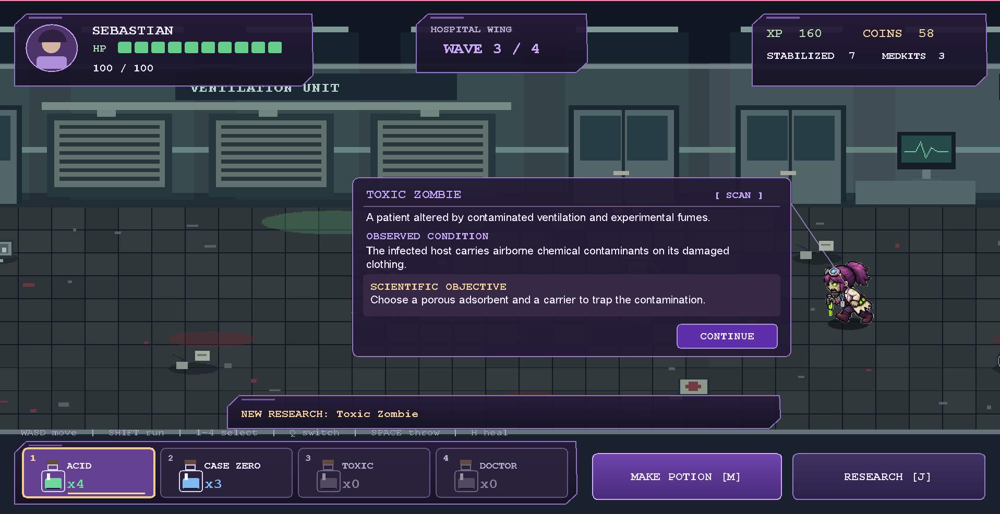
</p>

Players investigate a contaminated hospital where failed treatments and chemical exposure have resulted in increasingly dangerous mutations.

| Classification | Details |
|---|---|
| Difficulty | Moderate |
| Enemies | Acid Zombie, Patient Zero, Toxic Zombie |
| Boss | Plague Doctor |
| Chemistry Challenges | Chemical Formulation and Potion Crafting |

---

### Level 03 — Toxic Chemical Factory

<p align="center">
  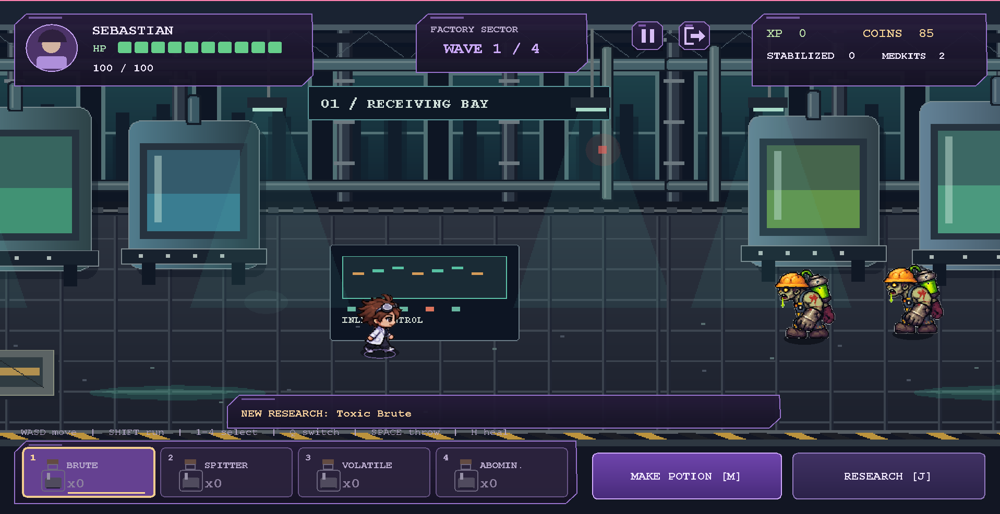
  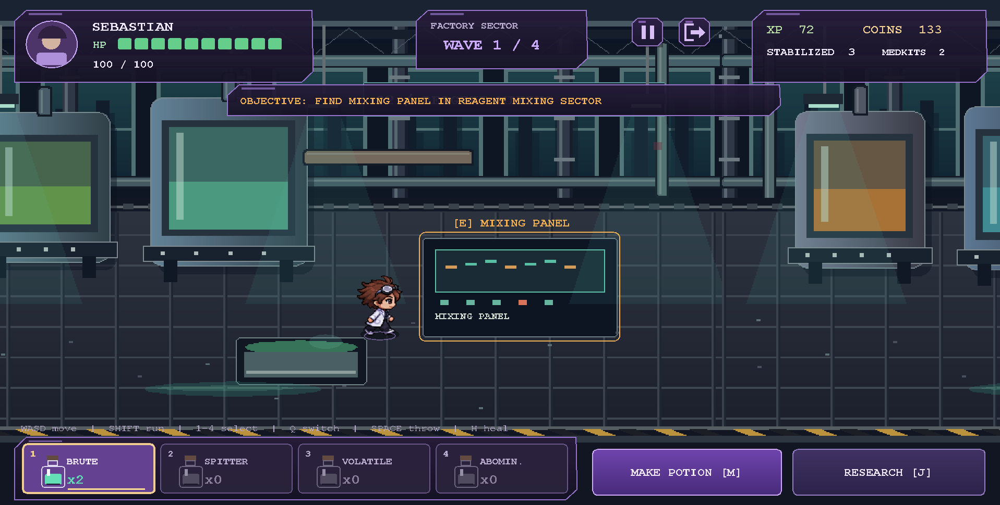
  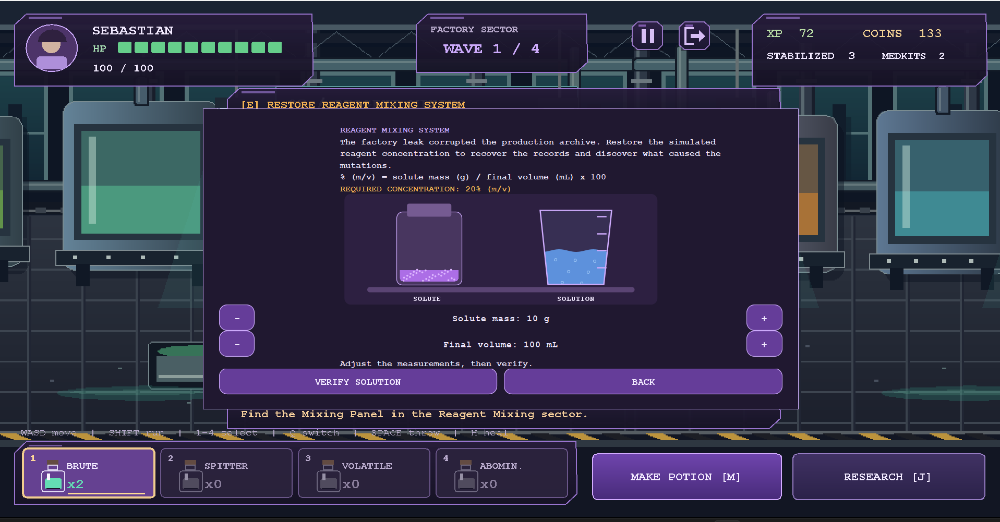
</p>

An industrial facility filled with hazardous substances, toxic mutations, and evidence of uncontrolled chemical experiments challenges the player's scientific knowledge.

Players apply concentration and dilution concepts to determine appropriate quantities of solute, solution, and solvent to complete chemical challenges and progress through the facility.

| Classification | Details |
|---|---|
| Difficulty | Challenging |
| Enemies | Toxic Brute, Venom Spitter, Explosive Zombie |
| Boss | Chemical Abomination |
| Chemistry Challenges | Chemical Formulation, Potion Crafting, Concentration, and Dilution |

---

### Level 04 — Lost Research Facility

<p align="center">
  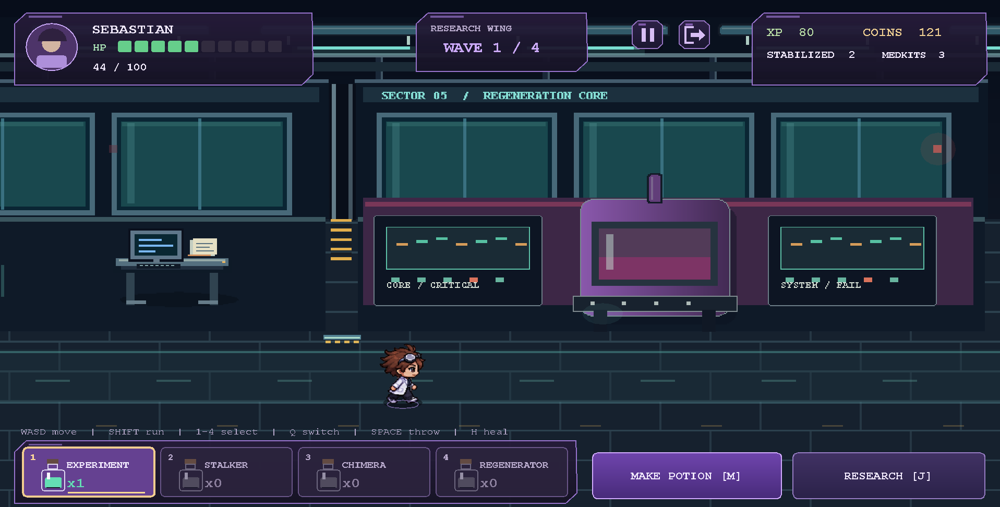
  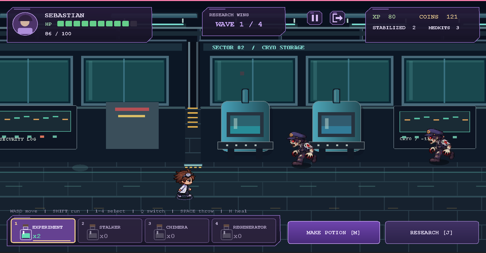
  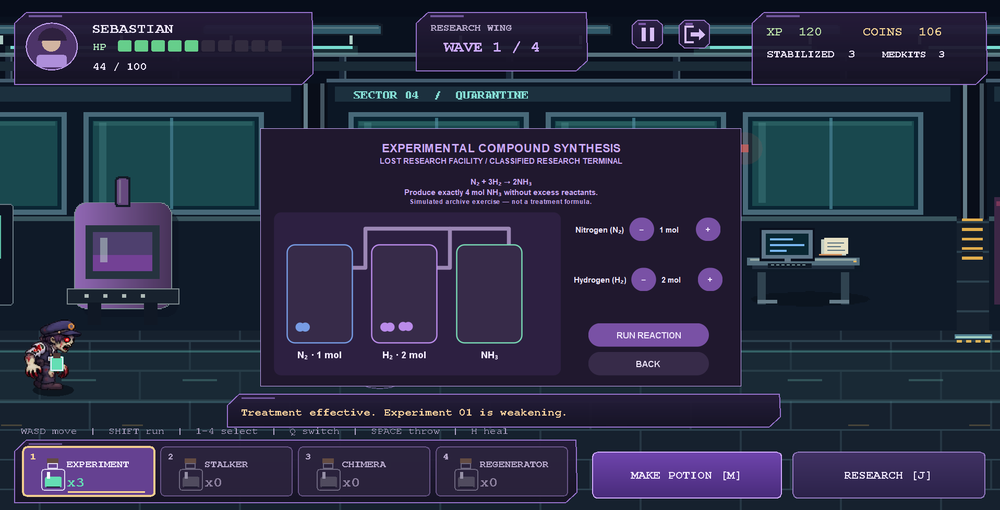
</p>

Players enter a restricted research facility containing damaged containment tanks, classified experiments, and disturbing discoveries about the development of the infection.

Stoichiometry challenges require players to determine reactant quantities, calculate product formation, and identify limiting and excess reactants to recover important research records and advance through the facility.

| Classification | Details |
|---|---|
| Difficulty | Hard |
| Enemies | Experiment 01, Mutant Stalker, Project Chimera |
| Boss | Regenerator Zombie |
| Chemistry Challenges | Chemical Formulation, Potion Crafting, Stoichiometry, and Limiting Reactants |

---

### Level 05 — Genesis Laboratory

The final investigation leads to the Genesis Laboratory, where the truth behind the outbreak is gradually revealed.

Unlike the previous levels, the Genesis Laboratory contains multiple research chambers with distinct environments, investigation objectives, chemical challenges, and enemy encounters.

#### Entrance — Security Area

Players must overcome the laboratory's chemical security verification before entering the restricted research chambers.

#### Wave 01 — Presentation Hall

Investigate the location of the original scientific presentation and uncover information about the individuals involved in the experiment.

**Enemy:** Elite Infected

#### Wave 02 — Containment Vault

Explore the containment chamber and discover evidence of failed containment procedures and dangerous experimental mutations.

**Enemy:** Biohazard Guardian

#### Wave 03 — Evolution Wing

Uncover restricted research records that reveal the progression of the infection and the experiments responsible for its evolution.

**Enemy:** Alpha Mutant

#### Final Battle — Origin Vault

The final confrontation takes place in the heart of the Genesis Laboratory. Players must apply their accumulated scientific knowledge and develop specialized treatments to confront the source of the infection.

Throughout the Genesis Laboratory, players balance chemical equations to complete security verifications, recover classified research records, and gain access to restricted areas.

| Classification | Details |
|---|---|
| Difficulty | Final |
| Final Boss | Patient Zero: The Origin |
| Chemistry Challenges | Chemical Formulation, Potion Crafting, and Balancing Chemical Equations |

<p align="center">
  <i>Every discovery has led to this moment.</i>
</p>

---

## ⚗️ Chemistry Integration

CHEMION incorporates fundamental chemistry concepts into its gameplay, allowing players to learn through experimentation, exploration, problem-solving, and strategic decision-making.

| Chemistry Concept | Application in CHEMION |
|---|---|
| Element Symbols | Identify chemical elements through their corresponding symbols. |
| Atomic Numbers | Explore element identities and periodic table information. |
| Mixtures | Combine different chemical materials during potion preparation. |
| pH Scale | Understand acidic, basic, and neutral substances. |
| Chemical Formulas | Recognize the composition of chemical compounds. |
| Chemical Bonding | Explore how atoms combine to form compounds. |
| Concentration | Determine appropriate solution concentrations and perform dilution calculations. |
| Stoichiometry | Calculate reactant and product quantities and identify limiting reactants. |
| Balanced Chemical Equations | Apply the conservation of atoms by balancing chemical reactions. |

> **Educational Disclaimer:** The outbreak, mutations, and treatments presented in CHEMION are fictional. The game incorporates educational chemistry concepts but does not provide real medical treatments or laboratory procedures.

---

<h2 align="center">🔬 Chemistry Laboratory</h2>

The Chemistry Laboratory serves as the player's primary workspace for chemical experimentation, treatment preparation, ingredient management, and resource acquisition.

<table>
  <tr>
    <td align="center" width="50%">
      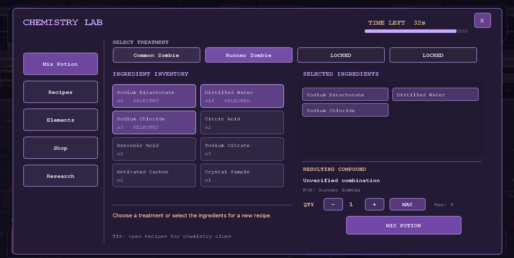
      <br>
      <b>Mix Potion</b>
      <br>
      Combine chemical ingredients to create specialized treatments.
    </td>
    <td align="center" width="50%">
      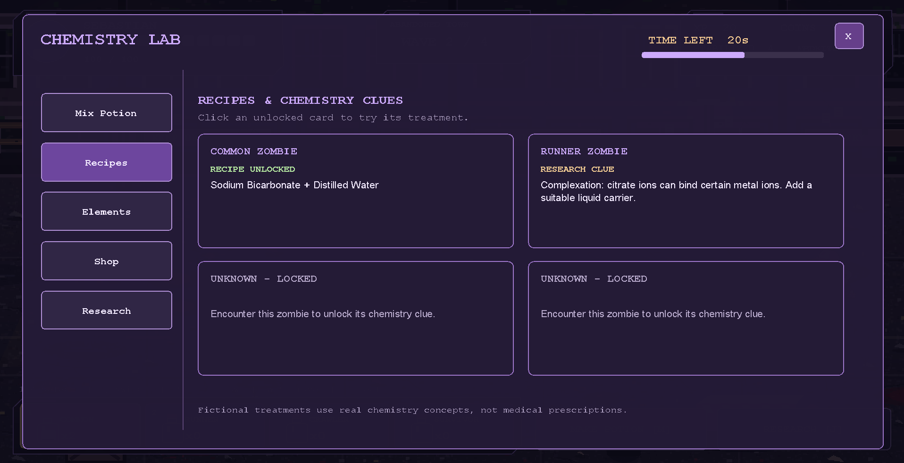
      <br>
      <b>Potion Recipes</b>
      <br>
      Review discovered recipes and their required ingredients.
    </td>
  </tr>
  <tr>
    <td align="center">
      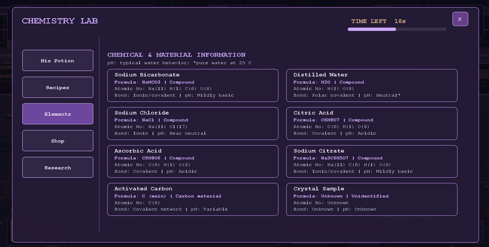
      <br>
      <b>Element Information</b>
      <br>
      Explore chemical symbols, atomic numbers, formulas, and properties.
    </td>
    <td align="center">
      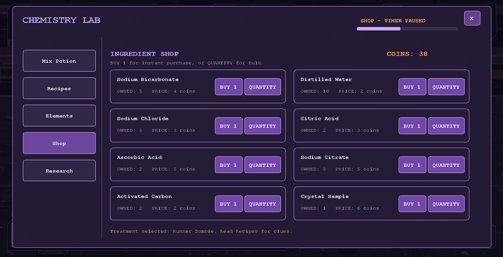
      <br>
      <b>Shop</b>
      <br>
      Purchase chemical materials and supplies using earned coins.
    </td>
  </tr>
</table>

### Potion Crafting

Successful treatment preparation requires players to analyze infected creatures, understand their chemical weaknesses, and select appropriate ingredients.

Incorrect combinations may result in unsuccessful crafting, encouraging players to review their research and improve their understanding.

---

<h2 align="center">📖 Research Journal</h2>

The Research Journal serves as the player's scientific reference throughout the game. It records discoveries, chemical information, enemy characteristics, and unlocked treatments.

The journal expands as players encounter new enemies, discover chemical information, and successfully develop treatments.

---

## 🕹️ Game Controls

| Key | Action |
|:---:|---|
| `W` `A` `S` `D` | Move Character |
| Arrow Keys | Alternative Movement |
| `Shift` | Sprint |
| `Space` | Throw Potion |
| `M` | Open Chemistry Laboratory |
| `J` | Open Research Journal |
| `E` | Interact with Objects and Research Terminals |
| Number Keys | Equip Potion |
| `Q` | Switch Potion |
| `H` | Use Healing Item |
| `P` | Pause Game |
| `Enter` | Continue Dialogue or Prompt |

> Certain controls and interactions depend on the current level and gameplay situation.

---

## 💻 OOP Principles Applied

CHEMION applies the four fundamental principles of Object-Oriented Programming to organize its game entities, manage gameplay behavior, promote code reusability, and maintain a modular program structure.

### 01 — Encapsulation

Encapsulation protects object attributes by restricting direct access and providing controlled methods for accessing or modifying their values.

#### Application in CHEMION

- Character health, position, and level management
- Scientist experience points and coins
- Inventory and resource management
- Zombie health and treatment resistance

The `Character` class uses private attributes to store character information. Methods such as `takeDamage()` and `restoreHealth()` provide controlled modification of character health.

**Related Classes:**

- `Character.java`
- `Scientist.java`
- `Inventory.java`
- `Zombie.java`

---

### 02 — Inheritance

Inheritance allows specialized classes to reuse common attributes and behaviors from existing parent classes.

#### Application in CHEMION

The `Scientist` class extends the `Character` class, inheriting common character attributes and behaviors while introducing scientist-specific functionality.

Different zombie types also inherit shared properties and behaviors from the abstract `Zombie` class.

**Class Relationships:**

```text
Character
    └── Scientist

Zombie
    ├── CommonZombie
    ├── RunnerZombie
    ├── CrawlerZombie
    └── Other Specialized Zombie Types
```

**Related Classes:**

- `Character.java`
- `Scientist.java`
- `Zombie.java`
- `ZombieTypes.java`

---

### 03 — Polymorphism

Polymorphism allows objects to provide different implementations of shared methods according to their specific responsibilities.

#### Application in CHEMION

Different zombie types implement their own treatment responses and combat behaviors. Although they share common methods, their implementations may differ depending on their mutation characteristics.

The `Scientist` class also overrides inherited methods to provide player-specific behavior.

**Examples of Methods:**

- `move()`
- `useItem()`
- `attack()`
- `receiveTreatment()`
- `dropRewards()`

**Related Classes:**

- `Scientist.java`
- `Zombie.java`
- `ZombieTypes.java`

---

### 04 — Abstraction

Abstraction defines essential behaviors while hiding unnecessary implementation details.

#### Application in CHEMION

The abstract `Character` and `Zombie` classes define common attributes and required behaviors that their subclasses implement according to their specific responsibilities.

The laboratory, battle, inventory, and game management systems also separate complex gameplay operations into dedicated classes.

**Related Classes:**

- `Character.java`
- `Zombie.java`
- `LabSystem.java`
- `BattleSystem.java`
- `GameManager.java`

---

### Additional Programming Concepts

| Concept | Application |
|---|---|
| Classes and Objects | Representation of scientists, zombies, potions, elements, and game systems. |
| Constructors | Initialization of game objects and their attributes. |
| Access Modifiers | Controlled access to class attributes and methods. |
| Method Overriding | Specialized behavior for inherited methods. |
| Arrays and Collections | Management of enemies, ingredients, recipes, and inventory items. |
| Conditional Statements | Validation of gameplay conditions and player actions. |
| Loops and Iteration | Game updates, enemy management, and animation processing. |
| Exception Handling | Handling errors during resource loading and other operations. |
| Input Validation | Checking user input, quantities, and chemical combinations. |
| File Handling | Loading resources and managing saved game progress. |
| Event-Driven Programming | Processing keyboard, mouse, and graphical interface interactions. |

---

## 🛠️ Technologies and Tools

<p align="center">
  
  
  
  
</p>

| Technology / Tool | Purpose |
|---|---|
| Java | Primary programming language and game logic. |
| Java Swing | Graphical user interfaces and interactive components. |
| Java AWT | Graphics rendering, keyboard input, and visual processing. |
| Java Sound API | Background music and sound effects. |
| Visual Studio Code | Source code development and debugging. |
| Git | Version control and source code management. |
| GitHub | Repository hosting and team collaboration. |
| Piskel | Pixel-art and sprite development. |
| Draw.io | UML diagrams and system visualization. |

CHEMION is developed using Java and its graphical programming capabilities without relying on an external game engine.

---

## 📂 Project Structure

The project is organized into dedicated directories for game assets, battlefield implementations, core gameplay systems, and graphical interfaces.

```text
CHEMION-THE-LAST-CURE/
│
├── assets/
│   ├── audio/
│   ├── backgrounds/
│   ├── characters/
│   └── readme/
│
├── battlefield/
│   ├── level1/
│   │   ├── Level1GamePanel.java
│   │   └── SaveManager.java
│   │
│   ├── level2/
│   │   └── Level2GamePanel.java
│   │
│   ├── level3/
│   │   └── Level3GamePanel.java
│   │
│   ├── level4/
│   │   └── Level4GamePanel.java
│   │
│   └── level5/
│       └── Level5GamePanel.java
│
├── game/
│   ├── AudioManager.java
│   ├── BattleSystem.java
│   ├── Character.java
│   ├── ChemistryInfo.java
│   ├── Compound.java
│   ├── Element.java
│   ├── GameLevel.java
│   ├── GameManager.java
│   ├── GameplayBridge.java
│   ├── HealthEffects.java
│   ├── Inventory.java
│   ├── LabSystem.java
│   ├── LevelTransition.java
│   ├── Potion.java
│   ├── Recipe.java
│   ├── Reward.java
│   ├── Scientist.java
│   ├── Zombie.java
│   └── ZombieTypes.java
│
├── CharacterSelection.java
├── ContinueGame.java
├── GameInstructions.java
├── Main.java
├── OutbreakIntro.java
├── OutbreakIntro2.java
├── OutbreakIntro3.java
├── OutbreakIntro4.java
├── OutbreakIntro5.java
├── OutbreakEnding.java
├── GAME_ARCHITECTURE.md
├── README.md
└── .gitignore
```

### Core Classes and Responsibilities

| Class | Responsibility |
|---|---|
| `Character` | Defines common character attributes and behaviors. |
| `Scientist` | Manages player-specific actions, experience, rewards, and research. |
| `Zombie` | Defines common infected enemy attributes and behaviors. |
| `Element` | Stores chemical element information and properties. |
| `Compound` | Represents chemical compounds and their formulas. |
| `Potion` | Represents specialized treatments and their effects. |
| `Recipe` | Manages ingredient requirements and potion crafting. |
| `Inventory` | Handles collected chemical materials, potions, and other items. |
| `LabSystem` | Manages chemical analysis, ingredient mixing, and recipe discovery. |
| `BattleSystem` | Handles combat-related operations and treatment application. |
| `GameLevel` | Manages level objectives, completion, and progression. |
| `GameManager` | Coordinates overall game state, progress, and transitions. |

---

<h2 align="center">📐 UML Class Diagram</h2>

The Unified Modeling Language (UML) class diagram illustrates the structure of CHEMION, including its core classes, attributes, methods, and relationships.

The diagram demonstrates how the game's object-oriented components interact to support character management, chemistry systems, combat, inventory, and level progression.

---

## 🚀 How to Run the Program

### Option 01 — Desktop Application

CHEMION is intended to be distributed as a standalone desktop game application for Windows.

**Release Status:** Desktop application packaging and distribution are pending.

Once the desktop application is available:

1. Open the **Releases** section of this GitHub repository.
2. Download the latest Windows release.
3. Install or extract the application as instructed.
4. Launch CHEMION: The Last Cure.
5. Select **New Game** to begin your mission.

---

### Option 02 — Run from Source Code

#### Requirements

- Java Development Kit (JDK)
- Visual Studio Code or another Java-compatible IDE
- Extension Pack for Java, if using Visual Studio Code
- Git, if cloning the repository

#### Using Visual Studio Code

1. Download or clone this repository.
2. Extract the project folder if downloaded as a ZIP file.
3. Open the entire project folder in Visual Studio Code.
4. Ensure that the Java Development Kit and required Java extensions are installed.
5. Open `Main.java`.
6. Click the **Run** button above the main method.
7. Wait for the game to launch.

#### Using the Terminal

Open a terminal in the project's root directory.

Compile the program:

```bash
javac -encoding UTF-8 Main.java
```

Run the program:

```bash
java Main
```

> Keep the assets, battlefield, and game directories in their original locations to ensure that the program can access its required resources.

---

<h2 align="center">👥 Team Members</h2>

<h2 align="center">AVISALA</h2>

<p align="center">
  <i>Turning knowledge into innovation through code.</i>
</p>

<table align="center">
  <tr>
    <td align="center" width="33%">
      <a href="https://github.com/joenagene">
        
        <br>
        <b>Joena Gene B. Borillo</b>
      </a>
      <br>
      Project Developer
    </td>
    <td align="center" width="33%">
      <a href="https://github.com/Nicole-E9">
        
        <br>
        <b>Nicole S. Enmoceno</b>
      </a>
      <br>
      Project Developer
    </td>
    <td align="center" width="33%">
      <a href="https://github.com/mejia3">
        
        <br>
        <b>Marion Zebastian B. Mejia</b>
      </a>
      <br>
      Project Developer
    </td>
  </tr>
</table>

<p align="center">
  <b>Team 09 | CS 2101</b>
  <br>
  Bachelor of Science in Computer Science
  <br>
  College of Informatics and Computing Sciences
  <br>
  Batangas State University
  <br>
  The National Engineering University — Alangilan
</p>

<p align="center">
  <b>OOP 101 — Object-Oriented Programming</b>
  <br>
  First Semester, Academic Year 2026–2027
</p>

---

## 💜 Acknowledgment

The developers would like to express their sincere gratitude to their Object-Oriented Programming instructor for providing guidance, valuable feedback, and the opportunity to apply programming concepts through this project.

The team also extends its appreciation to everyone who shared ideas, provided constructive feedback, and supported the development of CHEMION: The Last Cure.

This project reflects the team's collaborative efforts, creativity, perseverance, and commitment to combining scientific education with interactive technology.

---

<h2 align="center">✨ Thank You</h2>

<p align="center">
  Thank you for exploring the world of CHEMION.
  <br><br>
  Every discovery brings us closer to the truth.
  <br>
  Every experiment brings us closer to survival.
  <br>
  Every cure brings humanity closer to hope.
</p>

<h3 align="center">
  THE WORLD IS INFECTED.
  <br>
  THE LAST CURE IS IN YOUR HANDS.
</h3>

<p align="center">
  <b>Developed by AVISALA</b>
  <br>
  CHEMION: The Last Cure © 2026
</p>

<p align="center">
  
  
  
</p>
